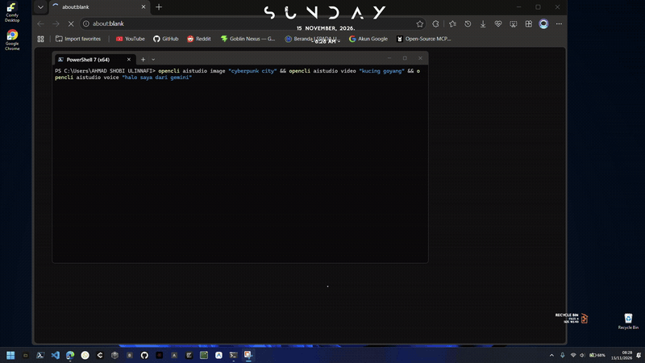

<p align="center">
  
</p>

<h1 align="center">Koleksi Plugin OpenCLI</h1>

<p align="center">
  Kumpulan plugin siap pakai untuk <b><a href="https://github.com/jackwener/opencli">OpenCLI</a></b> buat ngotomatisasi web apps langsung dari terminal dengan memanfaatkan sesi login browser aktif kalian.
</p>

<p align="center">
  <a href="./README.md"><b>English (US)</b></a> •
  <a href="./README.ind.md"><b>Bahasa Indonesia</b></a>
</p>

<p align="center">
  <a href="#-daftar-plugin"></a>
  <a href="LICENSE"></a>
  <a href="https://github.com/jackwener/opencli"></a>
</p>

<p align="center">
  
</p>

---

## 📦 Daftar Plugin

| Plugin | Layanan Target | Kemampuan Utama |
| :--- | :--- | :--- |
| **[`opencli-plugin-aistudio`](./opencli-plugin-aistudio)** | **Google AI Studio** | 🎬 **Gemini Omni 1.2 Flash** Video Gen<br>🎙️ **Gemini 3.8 Flash TTS** Voice Gen (2.000+ suara & ekspresi vocal)<br>🎨 **Nano Banana 2.1** Image Gen<br>💬 Prompting Web Playground langsung<br>✨ **ZERO API Key** (nebeng sesi login browser aktif) |
| **[`opencli-plugin-telegram`](./opencli-plugin-telegram)** | **Telegram Web** | 📩 Baca & kirim chat, pantau feed channel, interaksi bot button, dan simpan file ke cloud pribadi (*Saved Messages*). |
| **[`opencli-plugin-whatsapp`](./opencli-plugin-whatsapp)** | **WhatsApp Web** | 💬 Kirim pesan langsung ke nomor HP apa saja (tanpa lib bot tidak resmi / anti ban), pantau obrolan, dan download media. |

---

## ⚡ Prasyarat

1. **[OpenCLI](https://github.com/jackwener/opencli)** sudah terpasang di komputer:
   ```bash
   npm install -g @jackwener/opencli
   ```
2. **Ekstensi OpenCLI Browser Bridge** sudah dimuat di browser Chromium kalian (Chrome / Edge / Brave).
3. **OpenCLI Daemon** dalam kondisi aktif:
   ```bash
   opencli daemon restart
   ```

---

## 🛠️ Cara Pasang (Instalasi)

Clone repositori ini:
```bash
git clone https://github.com/amadshobi/opencli-plugins.git
cd opencli-plugins
```

Pasang plugin yang kalian mau secara lokal ke OpenCLI:

```bash
# Pasang plugin Google AI Studio
opencli plugin install ./opencli-plugin-aistudio

# Pasang plugin Telegram
opencli plugin install ./opencli-plugin-telegram

# Pasang plugin WhatsApp
opencli plugin install ./opencli-plugin-whatsapp
```

Cek daftar plugin yang sudah terpasang:
```bash
opencli plugin list
```

---

## 🌟 Sorotan Utama: `opencli aistudio` (Generatif Tanpa Biaya API)

Bikin klip video, rekaman suara TTS natural, dan gambar langsung dari terminal tanpa pusing mikirin biaya kuota API:

```bash
# 🎬 Generate klip video pake Gemini Omni 1.2 Flash
opencli aistudio video "Pemandangan drone cinematic di atas kota cyberpunk neon" --output "./renders/cyberpunk.mp4"

# 🎙️ Generate suara ekspresif pake Gemini 3.8 Flash TTS (pake tag emosi)
opencli aistudio voice "Wah gila... <gasp> beneran bisa jalan tanpa API key? <laugh> Mantap banget!" --voice Enya --output "./suara.wav"

# 🎨 Generate gambar pake Nano Banana 2.1
opencli aistudio image "Gadis anime retro lagi baca buku di kereta waktu hujan" --output "./gambar.png"
```

---

## ❓ Pertanyaan yang Sering Diajukan (FAQ)

### *Q: Ini ngejalanin Playwright / Puppeteer headless berat yang bikin RAM jebol ya?*
**A:** **Sama sekali bukan!** Plugin ini memanfaatkan **OpenCLI Chrome Extension Bridge** yang terhubung langsung ke profil browser harian kalian. Pemakaian RAM-nya hampir 0% tambahan karena cuma mengendalikan tab browser yang sudah ada tanpa memicu blokir anti-bot ataupun CAPTCHA.

### *Q: Harus punya API tier berbayar di Google AI Studio?*
**A:** **Gak perlu.** Selama akun kalian bisa membuka dan menggunakan [aistudio.google.com](https://aistudio.google.com) di browser, plugin ini langsung mengendalikan tampilan webnya buat merender dan otomatis menyimpan filenya ke harddisk kalian.

---

## 📄 Lisensi & Panduan Proyek

- **Lisensi**: [MIT](LICENSE) © [Ahmad Shobi](https://github.com/amadshobi)
- **Catatan Rilis**: Cek [CHANGELOG.md](CHANGELOG.md) untuk riwayat versi.
- **Kontribusi**: Cek [CONTRIBUTING.md](CONTRIBUTING.md) untuk panduan koding & aturan kontribusi.
- **Keamanan**: Cek [SECURITY.md](SECURITY.md) untuk pelaporan celah keamanan.
