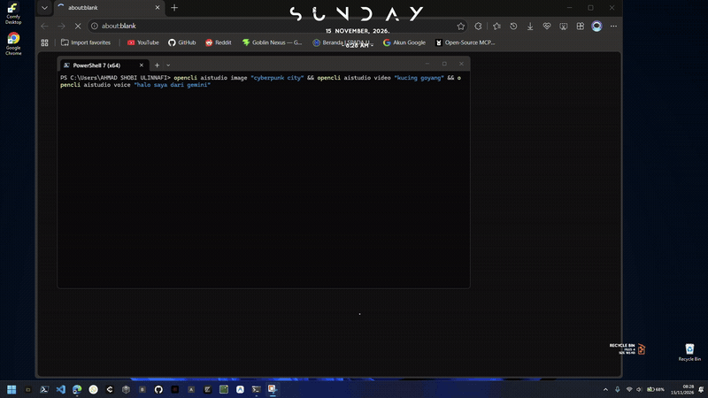

<p align="center">
  
</p>

<h1 align="center">OpenCLI Plugins Collection</h1>

<p align="center">
  A curated collection of production-grade plugins for <b><a href="https://github.com/jackwener/opencli">OpenCLI</a></b> to automate web applications directly from your terminal by driving authenticated browser sessions.
</p>

<p align="center">
  <a href="#-included-plugins"></a>
  <a href="LICENSE"></a>
  <a href="https://github.com/jackwener/opencli"></a>
</p>

<p align="center">
  
</p>

---

## 📦 Included Plugins

| Plugin | Target Service | Capabilities |
| :--- | :--- | :--- |
| **[`opencli-plugin-aistudio`](./opencli-plugin-aistudio)** | **Google AI Studio** | 🎬 **Gemini Omni 1.2 Flash** Video Gen<br>🎙️ **Gemini 3.8 Flash TTS** Voice Gen (2,000+ personas, vocal tags)<br>🎨 **Nano Banana 2.1** Image Gen<br>💬 Web Playground Prompt injection<br>✨ **Zero API key required** (uses active browser session) |
| **[`opencli-plugin-telegram`](./opencli-plugin-telegram)** | **Telegram Web** | 📩 Send & read messages, search chats, manage bots, and save media from Telegram Web. |
| **[`opencli-plugin-whatsapp`](./opencli-plugin-whatsapp)** | **WhatsApp Web** | 💬 Send text & attachments, query chat lists, and automate WhatsApp Web interactions. |

---

## ⚡ Prerequisites

1. **[OpenCLI](https://github.com/jackwener/opencli)** installed:
   ```bash
   npm install -g @jackwener/opencli
   ```
2. **OpenCLI Browser Bridge Extension** loaded in your Chromium browser (Chrome / Edge / Brave).
3. **OpenCLI Daemon** running:
   ```bash
   opencli daemon restart
   ```

---

## 🛠️ Installation

Clone the repository:
```bash
git clone https://github.com/amadshobi/opencli-plugins.git
cd opencli-plugins
```

Install any plugin locally into OpenCLI:

```bash
# Install AI Studio plugin
opencli plugin install ./opencli-plugin-aistudio

# Install Telegram plugin
opencli plugin install ./opencli-plugin-telegram

# Install WhatsApp plugin
opencli plugin install ./opencli-plugin-whatsapp
```

Verify installed plugins:
```bash
opencli plugin list
```

---

## 🌟 Spotlight: `opencli aistudio` (Zero-Cost Generative Suite)

Generate videos, emotional TTS voiceover, and images directly from your command line without paying for API quotas:

```bash
# 🎬 Generate video clip with Gemini Omni 1.2 Flash
opencli aistudio video "Drone shot flying through futuristic cyberpunk canyon" --output "./renders/canyon.mp4"

# 🎙️ Synthesize emotive speech with Gemini 3.8 Flash TTS & vocal tags
opencli aistudio voice "Wait... <gasp> you actually built this without an API key? <laugh> Amazing!" --voice Enya --output "./speech.wav"

# 🎨 Generate image with Nano Banana 2.1
opencli aistudio image "Retro anime girl reading in a rainy train" --output "./art.png"
```

---

## ❓ FAQ

### *Q: Does this run heavy headless Playwright / Puppeteer in the background?*
**A:** **No!** OpenCLI uses a lightweight **Chrome Extension Bridge** connected to your everyday browser profile. It consumes virtually zero additional RAM and reuses your existing logged-in sessions without triggering anti-bot challenges or CAPTCHAs.

### *Q: Do I need a paid API tier for AI Studio?*
**A:** **No.** As long as you can access [aistudio.google.com](https://aistudio.google.com) in your browser, this plugin drives the web interface directly to render and save assets to your local drive.

---

## 📄 License & Project Health

- **License**: [MIT](LICENSE) © [Ahmad Shobi](https://github.com/amadshobi)
- **Changelog**: See [CHANGELOG.md](CHANGELOG.md) for version release notes.
- **Contributing**: See [CONTRIBUTING.md](CONTRIBUTING.md) for local dev guide and guidelines.
- **Security**: See [SECURITY.md](SECURITY.md) for vulnerability reporting.
